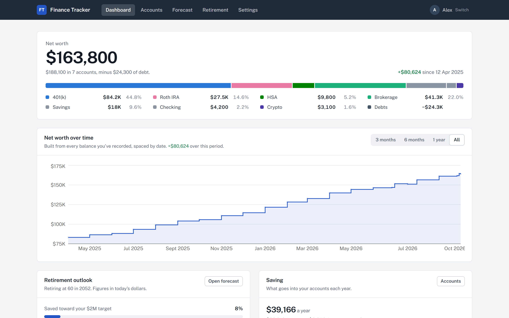
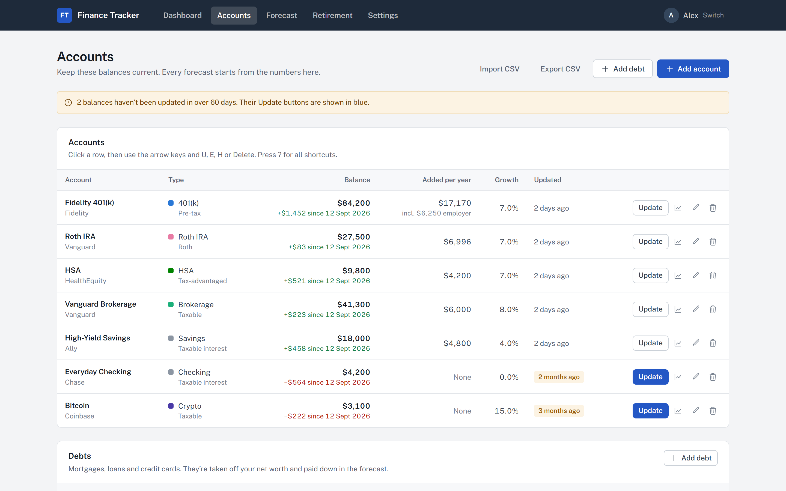
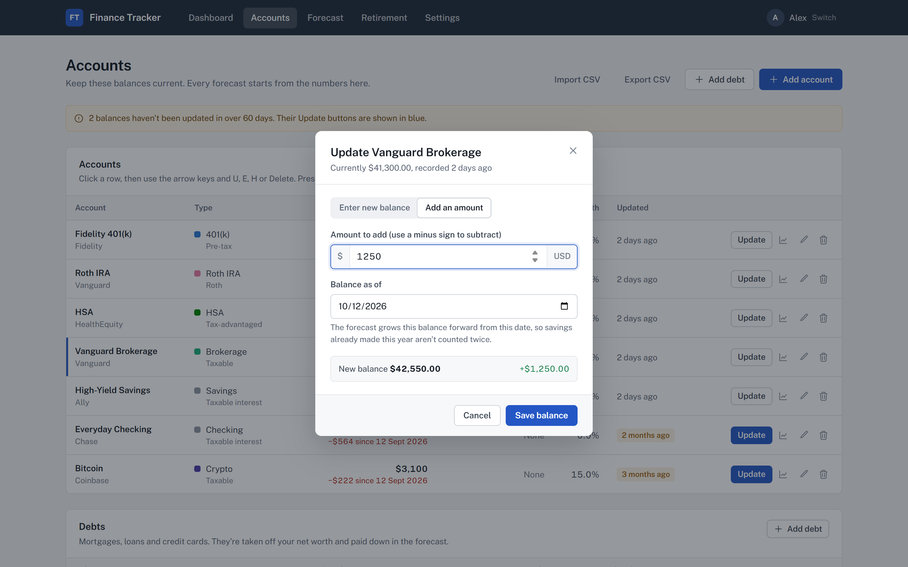
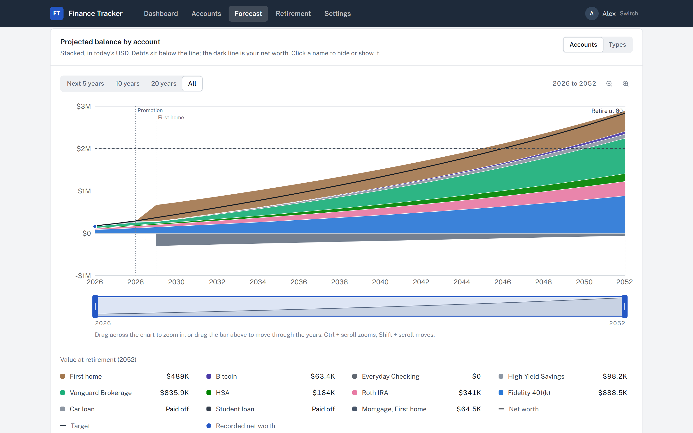
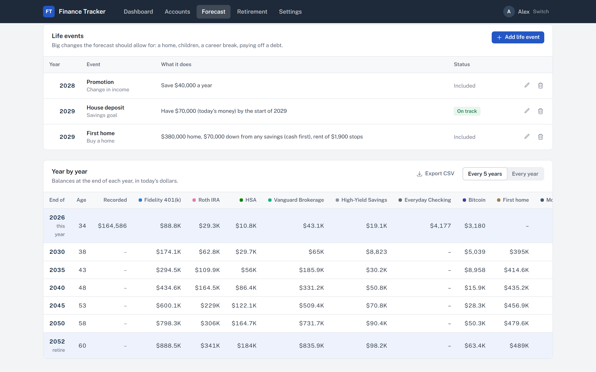
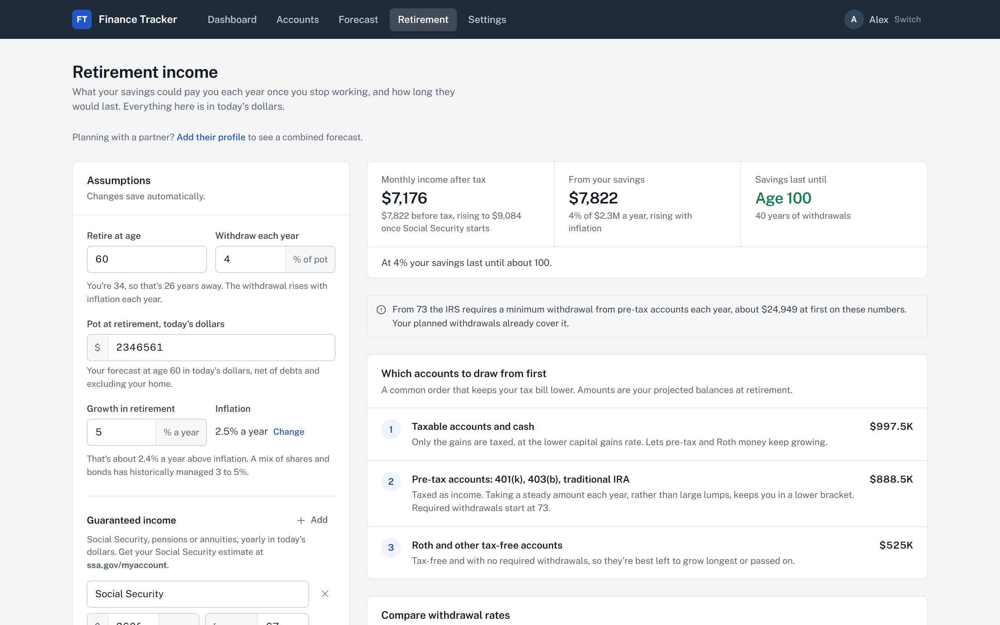
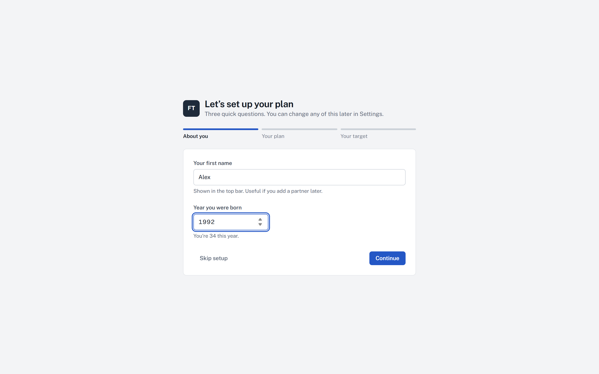

# Finance Tracker

A desktop app I built to keep track of my accounts and see where they're heading. It shows your net worth across every account and currency, projects each account forward to retirement, and works out what your savings could pay you once you stop working.

Everything stays on your computer. There's no sign-up, no bank login and no cloud sync.



## Download

**[Download the latest version for Windows](https://github.com/WillPerryyy/finance-tracker/releases/latest)**

There are two files on the release page:

- **Finance Tracker Setup 1.0.0.exe** installs the app and adds a desktop shortcut. Use this one.
- **FinanceTracker-1.0.0.exe** runs without installing, from anywhere, but takes a few seconds longer to open each time.

The app isn't code-signed (that costs a few hundred dollars a year), so Windows will probably show a blue "Windows protected your PC" box the first time. Click **More info**, then **Run anyway**.

It's Windows only for now.

## What it does

**Accounts and debts.** Add your 401(k), 403(b), IRA, Roth IRA, HSA, 529, brokerage, savings and checking accounts, plus UK pensions and ISAs. Each account can have regular contributions and an employer match (a fixed amount, a percentage of salary, or a match on what you put in). It warns you if you'd go over the IRS contribution limits. Mortgages, student loans and car loans are taken off your net worth.



**Updating balances.** Type in the balance from your statement or just add what you've saved. Every update is kept, so your net worth chart fills in over time. You can also import a CSV from your bank or broker, and set a monthly reminder.



**Forecast.** Every account projected to retirement in today's dollars, with debts paid down along the way. Zoom into any years, switch between accounts and account types, and add life events like buying a home, a promotion, having a child or a career break to see what they do to the picture.





**Retirement income.** What your savings could pay you each month after tax, how long it lasts at different withdrawal rates, when Social Security kicks in, and which accounts to draw from first.



When you first open it, three quick questions set up your plan:



The people and numbers in these screenshots are made up.

## Your data

Your data is saved in `%APPDATA%\finance-tracker\data` on your own computer. Nothing is uploaded. The app only goes online to fetch exchange rates (from open.er-api.com, falling back to frankfurter.app) and, if you set them up under Settings, crypto and stock prices.

Settings has a **Download a backup** button. Uninstalling the app from Windows Settings leaves your data in place; delete that folder too if you want it gone.

## A note on the numbers

This is a planning tool, not financial advice. Forecasts assume steady growth at the rates you choose, and real markets don't behave like that. Tax figures on the Retirement page are rough estimates from the rates you enter.

## Building it yourself

You'll need Node.js 20+ and Python 3.12+.

```bash
npm install
cd frontend && npm install && npm run build && cd ..
pip install -r backend/requirements.txt pyinstaller
py -m PyInstaller backend.spec --noconfirm
npx tsc -p tsconfig.electron.json
npx electron-builder --win
```

The installer ends up in `release/`. To work on it with live reload, run `py -m uvicorn backend.main:app --port 8200` in one terminal and `npm run dev` in `frontend/` in another.

The screenshots and promo video come from `marketing/`: `make_demo_data.py` writes the made-up demo profile and `capture.mjs` drives the app in Chrome to produce them.
